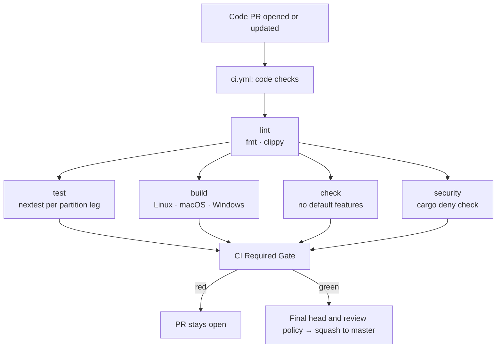
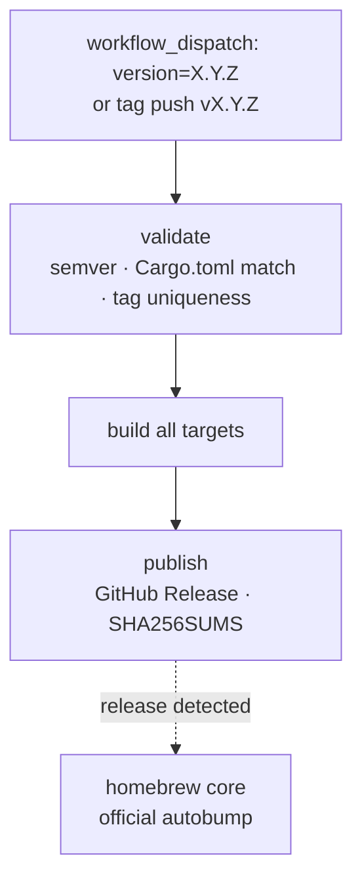

# Master Branch Delivery Flows

How code moves from a PR to a shipped release.

Use with:

- [`docs/book/src/maintainers/ci-and-actions.md`](../../docs/book/src/maintainers/ci-and-actions.md)
- [`docs/book/src/maintainers/release-runbook.md`](../../docs/book/src/maintainers/release-runbook.md)

Last reviewed: **November 2026** for `kckylechen1/zeroclaw`. This page describes fork policy and workflow behavior; verify live GitHub settings separately. The retained `merge_group` trigger is not evidence that this user-owned repository can enable a merge queue.

---

## Branching Model

ZeroClaw uses one default branch, `master`, with no permanent `dev` or promotion branch. Independent PRs target `master`. A dependent PR can temporarily target its parent branch; after the parent squash, replay only the child increment, retarget to current `master`, and inspect/validate the final result under [Stacked PRs](../../docs/book/src/maintainers/pr-workflow.md#stacked-prs).

This fork is maintained by `kckylechen1`; review routing is in [CODEOWNERS](../CODEOWNERS). Actual GitHub permissions and review requirements determine who can merge. Upstream maintainers are not automatic reviewers or milestone owners for this fork.

---

## Active Workflows

| File | Trigger | Purpose |
|---|---|---|
| `ci.yml` | `pull_request` → any base; `push` → `master`; `merge_group` (reserved) | Scope classification, docs validation, selected Rust/build checks, and the aggregate result; trusted code pushes also warm Rust caches. The reserved trigger does not enable a queue. |
| `release-stable-manual.yml` | `workflow_dispatch`, tag push `v*` | Stable release (manual, version-gated) |
| `cross-platform-build-manual.yml` | `workflow_dispatch` | Full platform build matrix (manual smoke check) |
| `cross-platform-clippy.yml` | `pull_request` when runtime, infra, or this workflow changes; `workflow_dispatch`; weekly schedule | Advisory full-workspace macOS/Windows Clippy, including test targets; outside the required PR gate |
| `docs-deploy.yml` | `push` → `master` (book, `xtask/`, `locales.toml` paths); tag push `v*`; nightly schedule; `workflow_dispatch` | Build and publish the versioned mdBook + rustdoc site to `gh-pages` |
| `pr-path-labeler.yml` | `pull_request` lifecycle | Automatic path-based PR labeling |

---

## Event Summary

| Event | What runs |
|---|---|
| PR opened or updated against `master` or a temporary parent branch | `ci.yml`; applicable docs/code checks and aggregate policy are described below. Runtime, infra, or cross-platform workflow changes also trigger `cross-platform-clippy.yml`. |
| `merge_group` | Reserved CI compatibility only. GitHub's merge-queue eligibility does not currently include this user-owned repository. |
| Push to `master` | `ci.yml` (scope-selected checks and docs style; code changes also warm trusted Rust caches; repository structure and Nix checks remain PR-only) and, when the book changes, `docs-deploy.yml` |
| Manual dispatch | `cross-platform-build-manual.yml`, `cross-platform-clippy.yml`, or `release-stable-manual.yml` |
| Tag push `vX.Y.Z` | `release-stable-manual.yml` (full release pipeline) |

There is no automatic release on merge. `ci.yml` does run after trusted
`master` pushes so post-merge Quality Gate runs can seed Rust caches for later
PRs, but releases remain intentional: either a manual dispatch or a deliberate
tag push.

---

## Step-by-Step

### 1) PR → `master`

1. Contributor opens or updates a PR with an explicit scope and dependency, if any. The final landing target is `master`.
2. Use `scripts/ci/change_scope.py` as the canonical diff classifier and `scripts/ci/required_gate.py` as the expected-result policy, wired by `ci.yml`. Ordinary README/book prose receives the Markdown, source/navigation, and local-link checks. Code, workflow, policy, build, configuration, executable, and unknown paths retain full coverage; missing or uncertain diff evidence does too. Navigation, renderer, generator, and preprocessor-input changes also run the real docs build. The aggregate always reports and rejects failed, cancelled, or unexpected missing/skipped work.
3. The code path includes:
   - `fmt`: `cargo fmt --all -- --check` (the Rust matrix waits on it; docs validation runs independently).
   - `lint`: `cargo clippy --workspace --all-targets --locked --features
     ci-all -- -D warnings`, plus the provider dispatch gate. This is the
     only all-features compile in the gate (benches included).
   - `build`: matrix across `x86_64-unknown-linux-gnu`,
     `aarch64-apple-darwin`, `x86_64-pc-windows-msvc`.
   - `check`: no default features.
   - `test`: `cargo nextest run --locked` per leg of
     `dev/ci/test-partition.json` (runtime, channels, app, tail); the runtime
     leg adds a filtered `sandbox-landlock` run, and the app leg runs the
     architecture guards.
   - `security`: `cargo deny check`, lockfile integrity, `cargo audit`.
   - `installer-drift`: `cargo generate installers --check` (PRs: only when
     manifests, `xtask/`, or generated install surfaces change).
   - `CI Required Gate`: stable aggregate for the classified result. Verify the actual required contexts rather than assuming cloud protection already uses this single job.
4. Review the final diff/head and check actual required CI and review policy. Carry out an already-authorized merge task without another yes/no exchange, keep monitoring pending checks, and squash with a final-head precondition. Verify GitHub's resulting state and merge SHA.

GitHub currently offers [merge queues](https://docs.github.com/en/repositories/configuring-branches-and-merges-in-your-repository/configuring-pull-request-merges/managing-a-merge-queue) for eligible organization-owned repositories. This fork's owner is a user, so queue enablement is not a one-click recovery option. The retained `merge_group` trigger can be useful if eligibility and configuration change later, but those facts and exact-result checks would need verification first. Do not confuse ordinary auto-merge with a merge queue or silently change repository ownership to obtain the feature.

### 2) Stable Release (manual)

See [`docs/book/src/maintainers/release-runbook.md`](../../docs/book/src/maintainers/release-runbook.md)
for the full procedure. In summary:

1. Maintainer verifies CI is green on the version bump PR.
2. Version bump PR is merged.
3. Maintainer triggers `release-stable-manual.yml` via `workflow_dispatch`
   with the version number, or pushes an annotated tag `vX.Y.Z`.
4. Workflow builds all targets, creates the GitHub Release, updates Scoop and
   AUR, and sends announcements. Homebrew Core discovers the release through
   its own autobump service.
5. Maintainer approves the `github-releases` environment gate
   when prompted.

### 3) Full Platform Build (manual)

1. Maintainer runs `cross-platform-build-manual.yml` via `workflow_dispatch`.
2. Build-only across additional targets not covered by the PR build matrix.
3. No tests, no publish. Used to verify cross-compilation health.

---

## Build Targets by Workflow

| Target | `ci.yml` | `cross-platform-build-manual.yml` | `release-stable-manual.yml` |
|---|:---:|:---:|:---:|
| `x86_64-unknown-linux-gnu` | ✓ | ✓ | ✓ |
| `aarch64-unknown-linux-gnu` | | ✓ | ✓ |
| `armv7-unknown-linux-gnueabihf` | | ✓ | ✓ |
| `arm-unknown-linux-gnueabihf` | | ✓ | ✓ |
| `aarch64-apple-darwin` | ✓ | ✓ | ✓ |
| `aarch64-linux-android` | | ✓ | ✓ (experimental) |
| `x86_64-apple-darwin` | | ✓ | ✓ |
| `x86_64-pc-windows-msvc` | ✓ | ✓ | ✓ |

---

## Diagrams

### Code PR to master

### Stable release

---

## Troubleshooting

1. **Gate red on PR**: check the `lint` job first (fmt/clippy failures are
   the most common cause), then `test`, then `build`.
2. **Release validate failed**: `Cargo.toml` version does not match the
   input, or the tag already exists. Fix the version bump PR and re-trigger.
3. **Need a full cross-platform build**: run `cross-platform-build-manual.yml`
   manually from the Actions tab.
