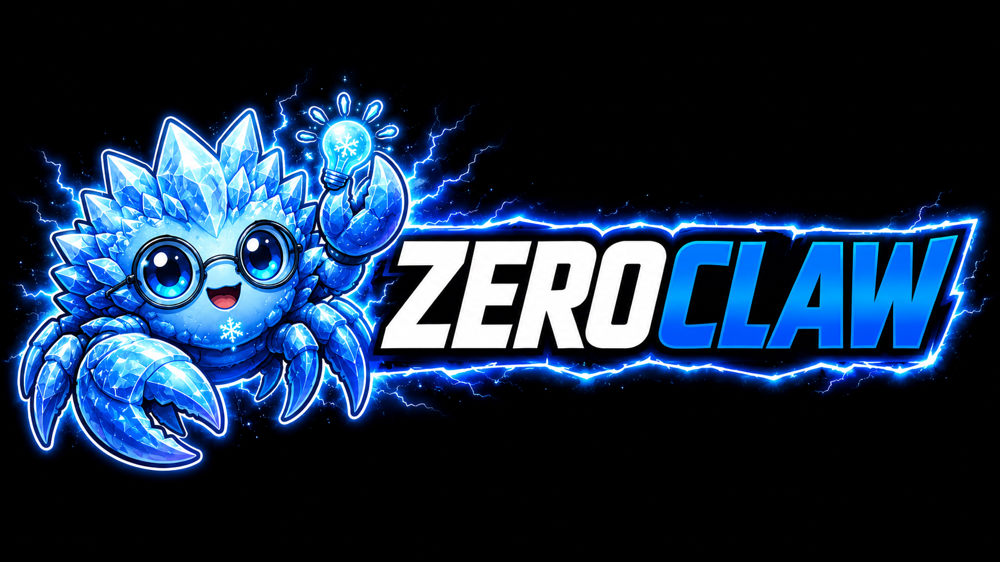

<p align="center">
  
</p>

<h1 align="center">🦀 ZeroClaw — Personal AI Assistant</h1>

<p align="center">
  <strong>You own the agent. You own the data. You own the machine it runs on.</strong>
</p>

<p align="center">
  <a href="LICENSE-APACHE"></a>
  <a href="https://www.rust-lang.org"></a>
</p>

<p align="center">
  <a href="#what-this-fork-is">What this fork is</a> ·
  <a href="#status">Status</a> ·
  <a href="AGENTS.md">Fork rules</a> ·
  <a href="docs/book/src/architecture/decisions/ADR-017-personal-agent-body-edges-and-delegation.md">ADR-017</a> ·
  <a href="docs/book/src/contributing/fork-notes.md">Fork notes</a>
</p>

---

> **Independent fork.** This repository (`kckylechen1/zeroclaw`) is an
> independently maintained fork, **not** the official ZeroClaw Labs repository
> or release. See [Official upstream and fork identity](#official-upstream-and-fork-identity).

## What this fork is

This fork turns upstream ZeroClaw into a **personal controller**: one agent with
a lasting identity and memory that acts for its owner, and that manages
authorized external agent harnesses, tools, and edge devices as one package.

It is built around three ideas:

1. **One body.** A single always-on process on a computer you control (a Mac
   mini, a desktop, a home server). It holds the gateway, the agent loop, the
   Soul and companion memory, approvals, and the scheduler. It is the only
   identity you talk to.
2. **Edge devices join through the gateway.** A speaker, a phone, a watch, or a
   small robot connects as a **Client** (carries conversation) and/or a
   **Node** (offers bounded, typed capabilities such as "play audio" or "show a
   face"). Device safety such as emergency stop and speed limits stays on
   the device. The body never drives serial ports or GPIO itself.
3. **Heavy work is delegated, never hidden.** Coding jobs and long
   investigations go to CLI agents such as Codex or Claude Code, started and
   tracked by [Tachi](https://github.com/kckylechen1/Tachi). The body reads
   their output as evidence and reports back in its own voice.

### Three levels of work

Every request starts at the lowest level and moves up only when it has to.

| Level | Who does the work | Examples | Uses Tachi |
|---|---|---|---|
| **L0 Direct** | The body's own turn: tools, MCP servers, Node capabilities | weather, chat, reminders, memory, lights | never |
| **L1 Reason** | A bounded reasoning subagent inside the body, no side effects | compare options, summarize a long document | never |
| **L2 Delegate** | A CLI agent started and tracked by Tachi over MCP | fix a bug, write a script, long research | always |

Most requests end at L0. A spoken "what's the weather" never waits on Tachi.

### Rules that do not bend

- **You talk only to the body.** Delegated agents have no Soul, and they never
  receive your Soul or User Model data.
- **Fail closed, never fall back.** If Tachi is off or unreachable, L0 and L1
  keep working, and a delegation request gets a typed "unavailable" answer.
  Nothing is quietly run locally instead.
- **Voice never blocks on delegation.** The body acknowledges ("I've asked Codex
  to do it; I'll tell you when it's done") and ends the turn.
- **New external surfaces default closed.** `[tachi]` and `[nodes]` are disabled
  by default, Tachi accepts only loopback endpoints, and no harness or Node
  capability is available until you grant it explicitly.

Full details: [ADR-013](docs/book/src/architecture/decisions/ADR-013-channels-as-gateway-clients.md)
(channels as gateway clients) and
[ADR-017](docs/book/src/architecture/decisions/ADR-017-personal-agent-body-edges-and-delegation.md)
(one body, edge devices, delegation through Tachi).

## Status

This fork is mid-transition. The acceptance gates come from ADR-017; the
whole-package acceptance is tracked in #374.

| ADR-017 acceptance gate | Status |
|---|---|
| L0 request (e.g. weather) completes with Tachi stopped | Not yet recorded as accepted |
| Delegation with Tachi stopped returns a typed "unavailable" and runs nothing locally | ✅ Covered by tests |
| One real Codex or Claude Code job runs end to end: started, tracked, reported in the body's voice | ⏳ Open (#381) |
| Retire ZeroClaw's own ACP driver (`execution_subagent`) | ✅ Done (#526) |
| One headless Node pairs, advertises, is invoked, disconnects, reconnects, is revoked | ✅ Real-process loopback proof with safe `system.info` / `test.echo` (#514) |

**First physical body:** the Yonbo X1 companion robot (#535). Its dialogue
still runs through an interim adapter; switching that brain to ZeroClaw (S5)
and enabling its face capability as a Node (S8) are pending.

Also still in progress: moving channels out of process into gateway bridges
(ADR-013), so `crates/zeroclaw-channels` remains in the workspace for now.

## Install

Clone this fork and use its installer in source mode (upstream prebuilt
releases do not certify this fork's code):

```bash
git clone --recurse-submodules https://github.com/kckylechen1/zeroclaw.git
cd zeroclaw
./install.sh --source
```

> The upstream one-line installer
> (`curl -fsSL https://raw.githubusercontent.com/zeroclaw-labs/zeroclaw/master/install.sh | bash`)
> installs **upstream ZeroClaw**, not this fork.

When run from a clone in an interactive terminal, `./install.sh` lets you pick
apps and optional features. For an unconfigured install, it then offers CLI or
browser-based Quickstart. Use `--skip-quickstart` when you only want to install.

> **Working on the docs?** The translated documentation catalogues live in a
> git submodule (`docs/book/po`). The Rust build does not need it, but building
> or syncing the docs does:
>
> ```bash
> git submodule update --init docs/book/po   # existing clone
> ```

Flags:

```
./install.sh --source                # always build from source
./install.sh --preset minimal        # kernel-only source preset (~6.6 MB)
./install.sh --minimal               # alias for --preset minimal
./install.sh --source --features agent-runtime,channel-discord  # custom feature set
./install.sh --with-gateway          # force gateway support on
./install.sh --without-gateway       # force gateway support off
./install.sh --prefix /tmp/zc-test   # install under a custom prefix
./install.sh --dry-run --source      # preview without installing
./install.sh --skip-quickstart       # install only, run `zeroclaw quickstart` later
./install.sh --list-features         # print available feature flags
./install.sh --uninstall             # remove ZeroClaw
```

Platform-specific notes: [Linux](docs/book/src/setup/linux.md) · [macOS](docs/book/src/setup/macos.md) · [Windows](docs/book/src/setup/windows.md) · [FreeBSD](docs/book/src/setup/freebsd.md) · [NixOS](docs/book/src/setup/nixos.md) · [Docker](docs/book/src/setup/container.md)

## Quick start

```bash
zeroclaw quickstart               # one-shot setup: pick a provider, write a working config
zeroclaw chat -a <alias>          # chat with the [agents.<alias>] entry through the gateway
zeroclaw service install          # register as systemd/launchctl/Windows Service
zeroclaw service start            # run it always-on in the background
```

Full walkthrough: [Quick start](docs/book/src/getting-started/quickstart.md) — or skip the safety gates with [YOLO mode](docs/book/src/getting-started/yolo.md) for dev boxes.

To enable delegation, run a Tachi daemon on the same machine, enable `[tachi]`
with a loopback endpoint, and map at least one harness in `[tachi.harnesses]`.
See [Delegation and SubAgents](docs/book/src/agents/delegation.md#external-work-through-tachi).

To try a local read-only Node, build with the `nodes` feature and follow
[Local read-only Node host](docs/book/src/gateway/api.md#local-read-only-node-host).

## Capabilities

- **Gateway-first** — the local CLI and the gateway (REST plus the `/ws/chat`
  event stream) are the only doors to the agent. Messaging platforms become
  bridges that talk to the gateway (ADR-013).
- **Soul and User Model** — a lasting identity and owner model with protected
  authority (ADR-014/015/016/018).
- **Provider-agnostic** — [model providers](docs/book/src/providers/overview.md) are pluggable: Anthropic, OpenAI, local Ollama, or any OpenAI-compatible endpoint, with [fallback chains and routing](docs/book/src/providers/routing.md).
- **Security-first** — default autonomy is `supervised`: medium-risk ops require approval, high-risk blocked. Workspace boundaries, command policy, OS-level sandboxes (Landlock / Bubblewrap / Seatbelt / Docker), and [tool receipts](docs/book/src/security/tool-receipts.md). This fork keeps several deliberately stricter defaults than upstream; see [fork notes](docs/book/src/contributing/fork-notes.md#deliberate-behavioral-divergences).
- **Edge devices as Nodes** — signed Ed25519 device identity, the v2 handshake,
  owner-set capability ceilings, and bounded invocation of safe capabilities
  through the opt-in `zeroclaw-node-host` (#514). Each call is bound to the
  device, connection and capability revision; unknown outcomes are never
  replayed. High-risk capabilities stay unavailable.
- **Delegation through Tachi** — L2 work goes over MCP to Tachi's `tachi_staff` (start / status / result / cancel), with typed errors and no local fallback.
- **SOP definitions** — event-trigger-format [Standard Operating Procedures](docs/book/src/sop/index.md), authored and validated in ZeroClaw; SOP runs live Tachi-side.
- **ACP** — IDE / editor integration via [Agent Client Protocol](docs/book/src/channels/acp.md) (JSON-RPC 2.0 over stdio).

## Configuration

One TOML file at `~/.zeroclaw/config.toml`. Pointers:

- [Provider configuration](docs/book/src/providers/configuration.md) — the universal `[providers.models.<type>.<alias>]` schema
- [Security overview](docs/book/src/security/overview.md) — autonomy, sandboxing, tool receipts
- [Delegation and SubAgents](docs/book/src/agents/delegation.md) — `[tachi]` and `[tachi.harnesses]`

A V3 config has at minimum four section headers (`<type>.<alias>` shaped) — a provider entry, an agent that references it, and a risk profile the agent gates against. See [Provider Configuration → Minimal working example](docs/book/src/providers/configuration.md#minimal-working-example).

For standard OpenAI Codex subscription auth, Quickstart can write the provider
entry for you:

```bash
zeroclaw auth login --model-provider openai-codex --import ~/.codex/auth.json  # if already signed in with Codex CLI
zeroclaw quickstart --model-provider openai-codex --model gpt-5.4
```

The provider entry uses the canonical OpenAI shape; the alias below is an
example:

```toml
[providers.models.openai.coding]   # type = openai; alias = coding (you choose)
model = "gpt-5.4"
wire_api = "responses"
requires_openai_auth = true
```

…and point your agent at it with `model_provider = "openai.<alias>"`.

Notes:

- Normal OpenAI Codex subscription auth uses stored auth profiles, not an `api_key` on the provider entry.
- Claude Max setup-token auth stays on the canonical Anthropic slot: run `claude setup-token`, choose `setup_token` in Quickstart, and paste the generated token into the API key/token prompt.
- Only set `api_key` / `uri` on `[providers.models.openai.<alias>]` when intentionally targeting a custom OpenAI-compatible gateway or endpoint.
- If you see `provider streaming failed, falling back to non-streaming chat`, ZeroClaw retries the same request in non-streaming mode. Check `zeroclaw auth status` before changing provider config.

## Architecture

```
  Clients: CLI · phone · speaker · robot dialogue · messaging bridges
                       │  REST + /ws/chat
                       ▼
┌──────────────────────────────────────────────────────────┐
│                  The body (one process)                   │
│                                                          │
│   gateway ── agent loop ── approvals ── scheduler        │
│                   │                                      │
│        Soul · User Model · memory                        │
│                   │                                      │
│   L0 tools / MCP    L1 reasoning      L2 delegation ─────┼──► Tachi (MCP, loopback)
│                                                          │       └─► Codex / Claude Code / …
└──────────────────────────┬───────────────────────────────┘
                           │ /ws/nodes (v2 handshake, signed identity)
                           ▼
          Nodes: node host · robot adapter · speaker (local safety)
```

More detail: [ADR-013](docs/book/src/architecture/decisions/ADR-013-channels-as-gateway-clients.md) · [ADR-017](docs/book/src/architecture/decisions/ADR-017-personal-agent-body-edges-and-delegation.md) · [Architecture overview](docs/book/src/architecture/overview.md) · [Crates](docs/book/src/architecture/crates.md). Some upstream architecture pages still describe the multi-channel layout.

## Contributing

Read [AGENTS.md](AGENTS.md) first. The short version:

- Read #388 (direction baseline), then #374 (execution index), then your slice's issue.
- One issue slice = one PR, on a non-`master` branch, with a conventional-commit title.
- Check upstream before writing a capability; replace before deleting.

Good places to start:

- New messaging bridge → `bridges/` (a client of the gateway, ADR-013)
- New provider → `crates/zeroclaw-providers/`
- New tool → `crates/zeroclaw-tools/`
- Docs → `docs/book/src/`

<!-- BEGIN:RECENT_CONTRIBUTORS -->
<!-- END:RECENT_CONTRIBUTORS -->

## Security

Do not file public issues for security vulnerabilities. See [SECURITY.md](SECURITY.md) for the policy.

## Official upstream and fork identity

The official upstream ZeroClaw Labs repository is
<https://github.com/zeroclaw-labs/zeroclaw>.

This repository (`kckylechen1/zeroclaw`) is an independent fork and does
**not** claim to be an official ZeroClaw Labs distribution or to be
affiliated with its maintainers. Upstream documentation, release links and
contribution information refer to upstream unless explicitly marked as
fork-specific.

## License

Dual-licensed: [MIT](LICENSE-MIT) OR [Apache 2.0](LICENSE-APACHE). You may choose either. Contributors automatically grant rights under both — see [CLA](docs/book/src/contributing/cla.md). The **ZeroClaw** name and logo are trademarks of ZeroClaw Labs.

Tachi is AGPL-3.0-only. Calling it over MCP as a separate process leaves this
project's license unchanged. The optional `memory-tachi` feature links memcore
directly; a binary built with it and distributed to others is covered by the
AGPL (see ADR-017 §6).

## Credits

Upstream ZeroClaw is built and maintained by its community — original creator [@theonlyhennygod](https://github.com/theonlyhennygod); project lead [@JordanTheJet](https://github.com/JordanTheJet). Thanks to the communities that incubated early work: **Harvard University**, **MIT**, **Sundai Club**, and every upstream contributor.
